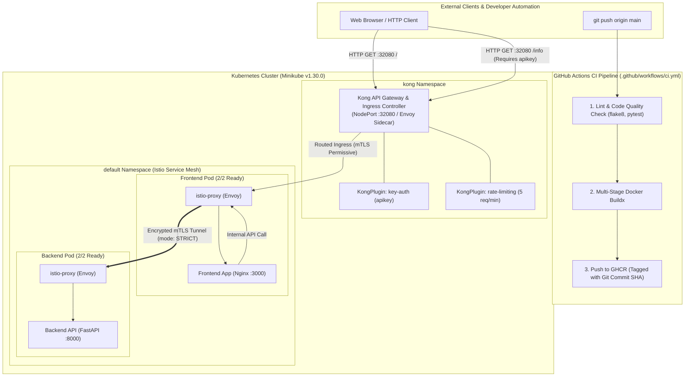

# Parallax DevOps Platform

[](https://www.parallaxlab.site/)
[](https://www.parallaxlab.site/)
[-238636?style=flat-square)](#)
[-238636?style=flat-square)](#)
[](#)

> **"Built different. Engineered better."**  
> A self-hosted enterprise infrastructure platform running entirely on local virtualization, engineered according to production-grade security, scalability, and 12-Factor principles.

---

## 📌 Executive Summary & Repository Lifecycle

This repository maintains the entire 6-week progressive infrastructure lifecycle, strictly honoring **The Single Repository Rule**.

| Milestone | Architecture Focus | Status | Core Technologies |
|:---|:---|:---:|:---|
| **Week 1** | Microservices & Containerization Foundation | **Accepted (100/100)** | FastAPI, Nginx Alpine, Docker Multi-Stage, Non-Root (`USER 1001`) |
| **Week 2** | Helm, Service Mesh & Strict mTLS | **Accepted (100/100)** | Minikube (K8s v1.30), Helm v4, Istio Service Mesh, Envoy Sidecars, Strict mTLS |
| **Week 3** | Kong Gateway & CI Pipeline | **Complete & Verified** | Kong Ingress Controller, Rate Limiting (5/min), API Key Auth, GitHub Actions, GHCR |
| **Week 4** | GitOps Continuous Deployment | Planned | ArgoCD, Declarative GitOps Sync, Automated Rollback |
| **Week 5** | Observability, Monitoring & Alerting | Planned | Prometheus, Grafana, Custom Dashboards, Alertmanager |
| **Week 6** | Canary Deployments & Final Project Polish | Planned | Flagger/Argo Rollouts, Canary Traffic Shifting, Production Hardening |

---

## 🚪 Week 3 Deliverable: Kong Gateway & CI Pipeline

### Weekly Milestone Objectives
- [x] **Kong API Gateway & Ingress Controller:** Installed via Helm in dedicated `kong` namespace, exposing Edge Ingress on NodePort 32080.
- [x] **Ingress Routing & Path Mapping:** Configured Ingress rules to route external client traffic (`/` to Frontend UI and `/info` to protected metadata contracts).
- [x] **Rate Limiting Security Plugin:** Enforced `KongPlugin: rate-limiting` (5 requests/minute per client). Successfully proven that the 6th rapid request returns `HTTP 429 Too Many Requests`.
- [x] **API Key Authentication:** Enforced `KongPlugin: key-auth` with `KongConsumer: parallax-developer`. Proven that requests without an API key are rejected with `HTTP 401 Unauthorized`, while requests with a valid key return `HTTP 200 OK`.
- [x] **Automated CI Pipeline (GitHub Actions):** Implemented `.github/workflows/ci.yml` to automatically run code linting/tests on push and build/push hardened Docker images to GitHub Container Registry (GHCR).
- [x] **Git Commit SHA Tagging Strategy:** Configured immutable container image tagging using Git commit short SHAs (`sha-${{ github.sha }}`) alongside `latest` for complete artifact traceability.

---

## 🏗️ End-to-End Enterprise Architecture



---

## 📂 Repository File Architecture

```text
parallax-devops-platform/
├── .github/
│   └── workflows/
│       └── ci.yml                    # Automated CI Pipeline (Lint, Test, Build, GHCR Push)
│
├── helm/
│   └── microservices/                # Consolidated Parameterized Helm Chart
│       ├── Chart.yaml                # Chart metadata (v1.0.0)
│       ├── values.yaml               # Parameterized configs (Gateway, Resources, Probes)
│       └── templates/
│           ├── backend-deployment.yaml   # Backend Deployment spec & probes
│           ├── backend-service.yaml      # Backend ClusterIP Service (:8000)
│           ├── frontend-deployment.yaml  # Frontend Deployment spec & probes
│           ├── frontend-service.yaml     # Frontend NodePort Service (:3000)
│           ├── ingress.yaml              # Kong Ingress rules (Public & Protected routes)
│           ├── kong-plugins.yaml         # KongPlugin (rate-limiting, key-auth, consumer, secret)
│           └── peer-authentication.yaml  # Istio PeerAuthentication policies
│
├── services/
│   ├── backend/                      # Python FastAPI JSON API Microservice
│   │   ├── app/
│   │   │   ├── __init__.py
│   │   │   └── main.py
│   │   ├── Dockerfile                # Multi-stage, non-root build
│   │   ├── .dockerignore
│   │   └── requirements.txt
│   │
│   └── frontend/                     # Lightweight HTTP Observability Dashboard
│       ├── src/
│       │   └── index.html
│       ├── nginx.conf
│       ├── Dockerfile                # Multi-stage, non-root build
│       └── .dockerignore
│
├── README.md                         # Primary project documentation
└── .gitignore                        # Standard enterprise ignore rules
```

---

## 🚀 Step-by-Step Reproduction & Deployment Guide

### 1. Initialize Minikube Cluster
```bash
minikube start --kubernetes-version=v1.30.0 --memory=6144 --cpus=3 --driver=docker
```

### 2. Install Istio Service Mesh
```bash
helm repo add istio https://istio-release.storage.googleapis.com/charts
helm repo update
kubectl create namespace istio-system
helm install istio-base istio/base -n istio-system --wait
helm install istiod istio/istiod -n istio-system --wait
kubectl label namespace default istio-injection=enabled
```

### 3. Install Kong API Gateway
```bash
helm repo add kong https://charts.konghq.com
helm repo update
kubectl create namespace kong
helm install kong kong/kong -n kong \
  --set proxy.type=NodePort \
  --set proxy.http.nodePort=32080 \
  --set resources.requests.cpu=100m,resources.requests.memory=256Mi
```

### 4. Deploy Microservices & Ingress via Helm
```bash
helm upgrade --install microservices ./helm/microservices
```

---

## 🧪 Verification & Proof of Execution

### A. Kong Ingress Routing: Public Frontend Exposed
Accessing the public dashboard through the Kong API Gateway proxy:
```bash
curl -i http://localhost:32080/health
```
**Output:**
```http
HTTP/1.1 200 OK
Content-Type: application/json
Content-Length: 89
Connection: keep-alive
server: envoy
X-Kong-Upstream-Latency: 5
X-Kong-Proxy-Latency: 0
Via: 1.1 kong/3.9.4

{"status":"healthy","service":"frontend-service","timestamp":"2026-10-19T10:53:25+00:00"}
```

---

### B. Kong Security: API Key Authentication Enforced (`401 Unauthorized`)
Attempting to access protected metadata `/info` without providing an API key:
```bash
curl -i http://localhost:32080/info
```
**Output:**
```http
HTTP/1.1 401 Unauthorized
Date: Mon, 19 Oct 2026 10:55:38 GMT
Content-Type: application/json; charset=utf-8
Connection: keep-alive
WWW-Authenticate: Key
Server: kong/3.9.4

{
  "message": "No API key found in request"
}
```

---

### C. Kong Security: Authenticated Access with Valid API Key (`200 OK`)
Providing the registered consumer credential (`apikey: parallax-secret-key-2026`):
```bash
curl -i -H "apikey: parallax-secret-key-2026" http://localhost:32080/info
```
**Output:**
```http
HTTP/1.1 200 OK
Content-Type: application/json
RateLimit-Limit: 5
RateLimit-Remaining: 4
RateLimit-Reset: 5
X-RateLimit-Limit-Minute: 5
X-RateLimit-Remaining-Minute: 4
Server: envoy
Via: 1.1 kong/3.9.4

{"service":"frontend-service","version":"1.0.0","server":"Nginx Alpine","environment":"production"}
```

---

### D. Kong Security: Rate Limiting Enforcement (`429 Too Many Requests`)
After exceeding the configured quota of 5 requests per minute, Kong immediately throttles the client:
```bash
curl -i -H "apikey: parallax-secret-key-2026" http://localhost:32080/info
```
**Output:**
```http
HTTP/1.1 429 Too Many Requests
Date: Mon, 19 Oct 2026 10:56:16 GMT
Content-Type: application/json; charset=utf-8
RateLimit-Limit: 5
RateLimit-Remaining: 0
Retry-After: 44
Server: kong/3.9.4

{
  "message": "API rate limit exceeded"
}
```

---

### E. GitHub Actions CI Pipeline & Image Tagging Verification
The GitHub Actions workflow (`.github/workflows/ci.yml`) triggers on every push to `main`:
1. **Lint & Test:** Validates Python 3.11 syntax and runs FastAPI initialization checks.
2. **Build & Push:** Compiles non-root Docker images and publishes them to GitHub Container Registry (`ghcr.io`).
3. **Tagging Strategy:** Produces deterministic, immutable tags using Git commit short SHAs:
   - `ghcr.io/blosny/parallax-devops-platform/backend:sha-647af21`
   - `ghcr.io/blosny/parallax-devops-platform/frontend:sha-647af21`
   - `ghcr.io/blosny/parallax-devops-platform/backend:latest`
   - `ghcr.io/blosny/parallax-devops-platform/frontend:latest`

---

## 🛠️ Verified Prerequisites & CLI Toolchain

| Tool | Verified Version | Environment / Notes |
|:---|:---:|:---|
| **Kong API Gateway** | `v3.9.4` (Chart `v3.4.1`) | Cloud-native API Gateway & Ingress Controller |
| **Istio Service Mesh** | `v1.30.5` | Control plane (`istiod`) and Envoy data plane (`proxyv2`) |
| **Minikube** | `v1.39.0` (K8s `v1.30.0`) | Single-node Docker driver cluster (3 CPUs, 6144 MB RAM) |
| **Helm** | `v4.3.0` | Kubernetes package manager |
| **Docker Engine & CLI** | `v29.8.1` | Docker Desktop with WSL 2 integration |
| **kubectl** | `v1.36.1` | Kubernetes client CLI |
| **Terraform** | `v1.16.2` | Infrastructure as Code (IaC) provisioning tool |
| **Git** | `v2.55.0` | Distributed version control |

---

## 👤 Author
- **Engineer:** Bilgisayar Mühendisliği / DevOps Engineer Intern
- **Program:** Parallax Labs - Track B: 6-Week Standard Program
- **Repository:** [github.com/blosny/parallax-devops-platform](https://github.com/blosny/parallax-devops-platform)
