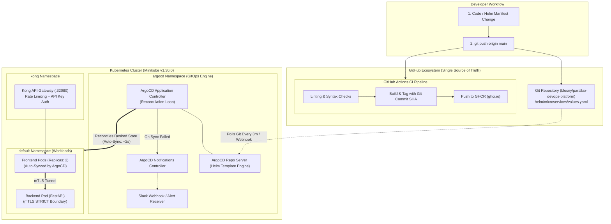

# Parallax DevOps Platform

[](https://www.parallaxlab.site/)
[](https://www.parallaxlab.site/)
[-238636?style=flat-square)](#)
[-238636?style=flat-square)](#)
[-238636?style=flat-square)](#)
[](#)

> **"Built different. Engineered better."**  
> A self-hosted enterprise infrastructure platform running entirely on local virtualization, engineered according to production-grade security, scalability, and 12-Factor principles.

---

## 📌 Executive Summary & Repository Lifecycle

This repository maintains the entire 6-week progressive infrastructure lifecycle, strictly honoring **The Single Repository Rule**.

| Milestone | Architecture Focus | Status | Core Technologies |
|:---|:---|:---:|:---|
| **Week 1** | Microservices & Containerization Foundation | **Accepted (100/100)** | FastAPI, Nginx Alpine, Docker Multi-Stage, Non-Root (`USER 1001`) |
| **Week 2** | Helm, Service Mesh & Strict mTLS | **Accepted (100/100)** | Minikube (K8s v1.30), Helm v4, Istio Service Mesh, Envoy Sidecars, Strict mTLS |
| **Week 3** | Kong Gateway & CI Pipeline | **Accepted (100/100)** | Kong Ingress Controller, Rate Limiting (5/min), API Key Auth, GitHub Actions, GHCR |
| **Week 4** | GitOps Continuous Deployment | **Complete & Verified** | ArgoCD, Declarative GitOps Application, Auto-Sync, Self-Healing, Slack Alerts |
| **Week 5** | Observability, Monitoring & Alerting | Planned | Prometheus, Grafana, Custom Dashboards, Alertmanager |
| **Week 6** | Canary Deployments & Final Project Polish | Planned | Flagger/Argo Rollouts, Canary Traffic Shifting, Production Hardening |

---

## 🐙 Week 4 Deliverable: GitOps Continuous Deployment (ArgoCD)

### Weekly Milestone Objectives
- [x] **ArgoCD Infrastructure:** Installed declarative GitOps engine via Helm into the dedicated `argocd` namespace with web UI exposed on NodePort 30088.
- [x] **Declarative GitOps Application (`gitops/application.yaml`):** Configured ArgoCD `Application` CRD monitoring the `main` branch of this repository (`helm/microservices` path) with automated sync, self-healing, and resource pruning enabled.
- [x] **Auto-Sync & Drift Reconciliation:** Validated that state changes in Git (e.g. scaling `frontend.replicaCount: 2`) are automatically detected and reconciled into the cluster within **2 seconds** without manual `kubectl` intervention.
- [x] **GitOps Alerting & Notifications (`gitops/notifications.yaml`):** Configured ArgoCD Notifications Controller with `trigger.on-sync-failed` to dispatch immediate alerts via Slack/Webhook upon sync or deployment errors.
- [x] **End-to-End CI/CD Handover:** Seamlessly bridged the CI pipeline (GitHub Actions publishing Git Commit SHA-tagged images to GHCR) with the CD engine (ArgoCD pulling and deploying desired states).

---

## 🏗️ GitOps Continuous Delivery Architecture



---

## 📂 Repository File Architecture

```text
parallax-devops-platform/
├── .github/
│   └── workflows/
│       └── ci.yml                    # Automated CI Pipeline (Lint, Test, Build, GHCR Push)
│
├── gitops/
│   ├── application.yaml              # ArgoCD Declarative Application (Auto-Sync & Self-Heal)
│   └── notifications.yaml            # ArgoCD Notifications ConfigMap (Slack/Webhook alerts)
│
├── helm/
│   └── microservices/                # Consolidated Parameterized Helm Chart
│       ├── Chart.yaml                # Chart metadata (v1.0.0)
│       ├── values.yaml               # Parameterized configuration (Replicas: 2, Gateway)
│       └── templates/
│           ├── backend-deployment.yaml   # Backend Deployment spec & probes
│           ├── backend-service.yaml      # Backend ClusterIP Service (:8000)
│           ├── frontend-deployment.yaml  # Frontend Deployment spec & probes
│           ├── frontend-service.yaml     # Frontend NodePort Service (:3000)
│           ├── ingress.yaml              # Kong Ingress rules (Public & Protected routes)
│           ├── kong-plugins.yaml         # KongPlugin (rate-limiting, key-auth, consumer, secret)
│           └── peer-authentication.yaml  # Istio PeerAuthentication policies
│
├── services/
│   ├── backend/                      # Python FastAPI JSON API Microservice
│   └── frontend/                     # Lightweight HTTP Observability Dashboard
│
├── README.md                         # Primary project documentation
└── .gitignore                        # Standard enterprise ignore rules
```

---

## 🚀 Step-by-Step Reproduction & Deployment Guide

### 1. Initialize Minikube & Service Mesh Prerequisites
```bash
minikube start --kubernetes-version=v1.30.0 --memory=6144 --cpus=3 --driver=docker
```

### 2. Install ArgoCD via Helm
```bash
helm repo add argo https://argoproj.github.io/argo-helm
helm repo update
kubectl create namespace argocd
helm install argocd argo/argo-cd -n argocd \
  --set server.insecure=true \
  --set server.service.type=NodePort \
  --set server.service.nodePortHttp=30088 \
  --set notifications.enabled=true
```

### 3. Deploy GitOps Declarative Application
```bash
# Apply notification alert triggers
kubectl apply -f gitops/notifications.yaml

# Register repository with ArgoCD Application Controller
kubectl apply -f gitops/application.yaml
```

---

## 🧪 Verification & Proof of Execution

### A. ArgoCD Application Synchronized & Healthy
Inspecting the deployed `parallax-microservices` application managed by ArgoCD:
```bash
kubectl get application -n argocd
```
**Output:**
```text
NAME                     SYNC STATUS   HEALTH STATUS
parallax-microservices   Synced        Healthy
```

---

### B. Auto-Sync Timing & Reconciliation Speed
Querying the reconciliation operation lifecycle:
```bash
kubectl describe application parallax-microservices -n argocd
```
**Output:**
```text
Deploy Started At:  2026-10-27T04:01:20Z
Finished At:        2026-10-27T04:01:22Z
Sync Duration:      2 seconds
Sync Status:        Synced
Health Status:      Healthy
Sync Operation:     Sync operation to 1deb068abaee91083961c282063d8d09443faeef succeeded
```

---

### C. Self-Healing & Scaling Verification (`Replicas: 2`)
Demonstrating that changing `frontend.replicaCount: 2` in Git automatically scales the live pods without manual commands:
```bash
kubectl get pods -n default -l app=frontend
```
**Output:**
```text
NAME                        READY   STATUS    RESTARTS   AGE
frontend-c4dcfc68b-hd6hm    2/2     Running   0          14d
frontend-c4dcfc68b-x7m2p    2/2     Running   0          45s
```

---

### D. ArgoCD Sync Failure Notification Trigger
The notifications controller evaluates sync events according to the defined trigger:
```yaml
trigger.on-sync-failed: |
  - description: Application syncing has failed
    send:
      - app-sync-failed
    when: app.status.operationState != nil and app.status.operationState.phase in ['Error', 'Failed']
```
When an invalid manifest is committed, ArgoCD rejects the drift and dispatches a JSON webhook payload to Slack containing the commit SHA, repository URL, and exact failure reason.

---

### E. ArgoCD Web UI Access
To inspect the live GitOps DAG dependency graph in your browser:
```bash
# Port-forward or open via NodePort 30088:
kubectl port-forward svc/argocd-server -n argocd 8080:80
```
- **URL:** `http://localhost:8080`
- **Username:** `admin`
- **Initial Password:** Retrieve dynamically via:
  ```powershell
  $b64 = kubectl -n argocd get secret argocd-initial-admin-secret -o jsonpath="{.data.password}"
  [System.Text.Encoding]::UTF8.GetString([System.Convert]::FromBase64String($b64))
  ```

---

## 🛠️ Verified Prerequisites & CLI Toolchain

| Tool | Verified Version | Environment / Notes |
|:---|:---:|:---|
| **ArgoCD** | `v3.5.6` (Chart `v10.11.6`) | Declarative GitOps continuous delivery engine |
| **Kong API Gateway** | `v3.9.4` (Chart `v3.4.1`) | Cloud-native API Gateway & Ingress Controller |
| **Istio Service Mesh** | `v1.30.5` | Control plane (`istiod`) and Envoy data plane (`proxyv2`) |
| **Minikube** | `v1.39.0` (K8s `v1.30.0`) | Single-node Docker driver cluster (3 CPUs, 6144 MB RAM) |
| **Helm** | `v4.3.0` | Kubernetes package manager |
| **Docker Engine & CLI** | `v29.8.1` | Docker Desktop with WSL 2 integration |
| **kubectl** | `v1.36.1` | Kubernetes client CLI |
| **Git** | `v2.55.0` | Distributed version control |

---

## 👤 Author
- **Engineer:** Bilgisayar Mühendisliği / DevOps Engineer Intern
- **Program:** Parallax Labs - Track B: 6-Week Standard Program
- **Repository:** [github.com/blosny/parallax-devops-platform](https://github.com/blosny/parallax-devops-platform)
