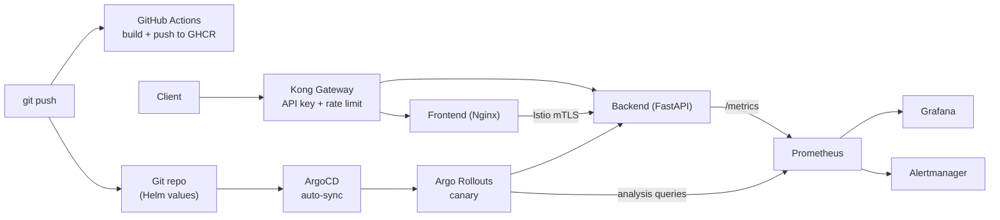

# Parallax DevOps Platform

[](https://www.parallaxlab.site/)
[](https://www.parallaxlab.site/)
[](#-weekly-progress)
[](https://www.parallaxlab.site/verify/PL-INT-2026-5840)

A small microservice platform built step by step on a local Kubernetes cluster (Minikube) during the 6-week **Parallax Labs DevOps Engineer Internship** (October – November 2026). Every week added one infrastructure layer on top of the previous one, all in this single repository.

**Stack:** Docker · Kubernetes (Minikube) · Helm · Istio · Kong · GitHub Actions · GHCR · ArgoCD · Prometheus · Grafana · Alertmanager · Argo Rollouts

---

## 📅 Weekly Progress

| Week | Topic | Result |
|:---:|:---|:---:|
| 1 | Microservices & containerization | Accepted (100/100) |
| 2 | Helm, Istio service mesh & strict mTLS | Accepted (100/100) |
| 3 | Kong API gateway & CI pipeline | Accepted (100/100) |
| 4 | GitOps continuous deployment (ArgoCD) | Accepted (100/100) |
| 5 | Observability, monitoring & alerting | Accepted (100/100) |
| 6 | Canary deployments & automated rollback | Completed (100/100) |

### Week 1 — Microservices & Containerization
- Wrote a **FastAPI** backend (`/health`, `/info`) and an **Nginx** frontend dashboard.
- Multi-stage Dockerfiles with small Alpine/slim images, running as a **non-root user** (`USER 1001`).
- Verified with `docker run` + `curl /health`.

### Week 2 — Helm, Service Mesh & mTLS
- Set up a Minikube cluster (K8s v1.30) and packaged both services into one parameterized **Helm chart** (`helm/microservices`).
- Installed **Istio**, enabled sidecar injection and enforced **STRICT mTLS** with `PeerAuthentication`.
- Tested it: frontend → backend inside the mesh works; a plain-text request from outside the mesh is rejected.

### Week 3 — API Gateway & CI
- Installed **Kong** as the ingress controller (NodePort `32080`).
- Added `rate-limiting` (5 req/min → `HTTP 429`) and `key-auth` (no key → `HTTP 401`) plugins.
- **GitHub Actions** pipeline: lint/test, build images, push to **GHCR** tagged with the Git commit SHA.

### Week 4 — GitOps with ArgoCD
- Installed **ArgoCD** and declared the app in `gitops/application.yaml` (auto-sync, self-heal, prune).
- Changing `replicaCount` in Git and pushing updates the cluster without any `kubectl` command (~2 s sync).
- Sync-failure notifications via ArgoCD Notifications (Slack / webhook).

### Week 5 — Observability & Alerting
- Installed **kube-prometheus-stack** with Helm; the backend exposes `/metrics` (request count, latency histogram).
- 16-panel **Grafana** dashboard for RED metrics, provisioned as code through a ConfigMap.
- 4 **Alertmanager** rules (high latency, 5xx error rate, crash loop, target down), tested with fault-injection endpoints and a load generator. Response steps are in the [SRE runbook](docs/RUNBOOK.md).

### Week 6 — Canary Deployments
- Replaced the backend `Deployment` with an **Argo Rollouts** `Rollout`: 20% → pause → 50% → pause → 100%.
- An `AnalysisTemplate` queries Prometheus during the rollout; if success rate < 95% or P95 latency > 500 ms, the rollout is **aborted and rolled back automatically**.
- `scripts/canary_demo.py` demonstrates both a successful promotion and an automatic rollback. Details: [docs/CANARY.md](docs/CANARY.md).

> **Note on canary weights:** no `trafficRouting` is configured, so Argo Rollouts reaches each weight by **scaling replicas**, not by splitting traffic in Istio or Kong. With 4 backend replicas, 20% means 1 canary pod (~25% of requests via normal Service load balancing) and 50% means 2 pods. Exact per-request splitting would need an Istio `VirtualService` under `strategy.canary.trafficRouting`.

---

## 🏗️ Final Architecture



---

## 🚀 Quick Start

Requirements: Docker, Minikube, kubectl, Helm (versions below). The bootstrap script installs Istio, Kong, ArgoCD, Argo Rollouts and the observability stack on a fresh Minikube cluster:

```bash
# Linux / macOS / WSL
./scripts/bootstrap.sh

# Windows PowerShell
./scripts/bootstrap.ps1
```

| Service | URL | Notes |
|:---|:---|:---|
| Kong Gateway | `http://localhost:32080` | header `apikey: parallax-secret-key-2026` |
| Frontend | `http://localhost:30080` | |
| ArgoCD | `http://localhost:30088` | user `admin`, password in `argocd-initial-admin-secret` |
| Grafana | `http://localhost:30300` | `admin` / `parallax-admin-2026` |
| Prometheus | `http://localhost:30090` | |
| Alertmanager | `http://localhost:30093` | |
| Argo Rollouts | `http://localhost:31031` | |

> ⚠️ The API key and passwords above are **local demo values only**, used on a throwaway Minikube cluster. Do not reuse them anywhere; a real environment would keep them in Kubernetes Secrets or a secret manager.

---

## 📂 Repository Layout

```text
.github/workflows/ci.yml   # CI: lint, test, build, push to GHCR
services/backend/          # FastAPI service (/health, /info, /metrics, /simulate/*)
services/frontend/         # Nginx dashboard
helm/microservices/        # App chart: Rollout, Services, Kong ingress & plugins, Istio mTLS, ServiceMonitor
helm/observability/        # kube-prometheus-stack values, Grafana dashboard, alert rules
gitops/                    # ArgoCD Applications + notifications
scripts/                   # bootstrap, load generator, alert triggers, canary demo
docs/                      # deliverable details, runbook, canary guide, notes
```

## 📚 Documentation

| File | Content |
|:---|:---|
| [docs/DELIVERABLES.md](docs/DELIVERABLES.md) | Full write-ups, verification outputs and commands for weeks 4–6 |
| [docs/RELEASES.md](docs/RELEASES.md) | Week-by-week development log (Turkish) |
| [docs/CANARY.md](docs/CANARY.md) | Canary lifecycle, PromQL analysis, rollback commands |
| [docs/RUNBOOK.md](docs/RUNBOOK.md) | Alert runbooks, SLOs and triage steps |
| [docs/NOTES.md](docs/NOTES.md) | Concept notes I wrote while learning (Turkish) |

## 🛠️ Verified Versions

| Tool | Version |
|:---|:---|
| Minikube | v1.39.0 (Kubernetes v1.30.0, 3 CPU, 6 GB RAM, Docker driver) |
| Helm | v4.3.0 |
| kubectl | v1.36.1 |
| Istio | v1.30.5 |
| Kong | v3.9.4 (chart v3.4.1) |
| ArgoCD | v3.5.6 (chart v10.11.6) |
| Argo Rollouts | v2.37.2 |
| Prometheus / Grafana / Alertmanager | v2.50.0 / v10.3.0 / v0.27.0 |
| Docker | v29.8.1 |

---

Built by [Taha Buğra Çiçek](https://www.linkedin.com/in/tahabugracicek/) as part of the Parallax Labs DevOps Engineer Internship.
