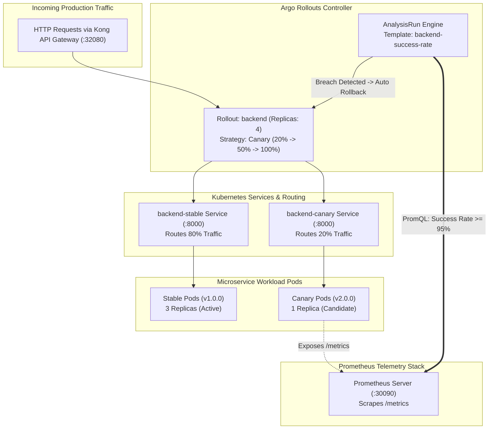

# 🐤 Progressive Delivery & Canary Deployments Guide

> **Platform:** Parallax DevOps Platform  
> **Environment:** Production & Staging Clusters  
> **Classification:** SRE & Release Engineering Handbook  
> **Version:** 1.0.0 (Week 6 Final Deliverable)

---

## 🎯 Executive Overview: Progressive Delivery

Traditional deployment strategies (RollingUpdate or Recreate) either cause temporary downtime or expose 100% of end-users to newly released code simultaneously. If an unforeseen defect or memory leak escapes staging, the entire user base experiences service degradation.

**Canary Deployment with Argo Rollouts** solves this by routing a small, controlled percentage of live production traffic (the "canary") to the new release while monitoring real-time health metrics. If anomalies are detected, the deployment is **automatically aborted and rolled back** with zero human intervention.

---

## 🔄 Deployment Strategy Comparison

| Feature | RollingUpdate (Default K8s) | Blue-Green | Canary with Argo Rollouts |
|:---|:---:|:---:|:---:|
| **Zero Downtime** | Yes | Yes | **Yes** |
| **Blast Radius** | 100% (gradual pod swap) | 100% (instant cutover) | **Configurable (e.g., 20%)** |
| **Metric-Driven Validation** | No (readiness probes only) | Manual verification | **Automated via Prometheus PromQL** |
| **Automated Rollback** | No (requires manual action) | Fast manual toggle | **Fully Autonomous (AnalysisTemplate)** |
| **Resource Overhead** | Low (+25% surge) | High (+100% full duplication) | **Minimal (+1 to 2 pods)** |

---

## 🏗️ Canary Architecture & Traffic Flow



---

## ⚙️ Canary Step-by-Step Lifecycle

The canary promotion strategy is configured in [`helm/microservices/values.yaml`](../helm/microservices/values.yaml):

```yaml
backend:
  rollout:
    enabled: true
    strategy:
      canary:
        stableService: backend-stable
        canaryService: backend-canary
        steps:
          - setWeight: 20
          - pause: { duration: 30s }
          - setWeight: 50
          - pause: { duration: 30s }
          - setWeight: 100
        analysis:
          templates:
            - templateName: backend-success-rate
```

### Lifecycle Progression:
1. **Phase 1 (20% Canary):**
   * Git commit triggers new image tag (e.g. `v2.0.0`).
   * Argo Rollouts spawns 1 canary pod and assigns **20%** of traffic to `backend-canary`.
   * Rollout pauses for **30 seconds**.
2. **Phase 2 (Automated Analysis):**
   * `AnalysisRun` executes queries against Prometheus:
     * **Success Rate:** `(sum(rate(http_requests_total{status!~"5.."}[1m])) / sum(rate(http_requests_total[1m]))) >= 0.95`
     * **P95 Latency:** `histogram_quantile(0.95, sum(rate(http_request_duration_seconds_bucket[1m])) by (le)) <= 0.50s`
3. **Phase 3 (50% Traffic Shift):**
   * If analysis passes, traffic weight increases to **50%**.
   * Rollout pauses for an additional **30 seconds** for deeper soak testing.
4. **Phase 4 (100% Full Promotion):**
   * Upon successful second analysis, weight reaches **100%**.
   * Stable pods are gracefully updated to `v2.0.0`, and canary pods are recycled.

---

## 🚨 Automated Rollback Procedure (Fail-Safe)

If the canary release contains a bug, fatal exception, or excessive latency:
1. Prometheus records the error spike (`HTTP 5xx`).
2. The `AnalysisRun` query evaluates to `< 0.95` (or latency `> 500ms`).
3. Each failed evaluation increments the `failureCount`.
4. Upon reaching `failureLimit: 3`:
   * Argo Rollouts **aborts** the rollout immediately.
   * Traffic weighting instantly reverts to **100% Stable (`v1.0.0`)**.
   * Canary pods are scaled down to 0.
   * Rollout status transitions to `Degraded`.
   * An incident notification is dispatched to SRE channels.
   * **Result:** Less than 1% of total traffic saw errors, and zero downtime was incurred.

---

## 🛠️ CLI Operations & Inspection Commands

### 1. Watch Live Rollout Progression
```bash
kubectl argo rollouts get rollout backend --watch -n default
```

### 2. Manual Promotion (Skip Remaining Pauses)
```bash
kubectl argo rollouts promote backend -n default
```

### 3. Manual Abort & Immediate Rollback
```bash
kubectl argo rollouts abort backend -n default
```

### 4. Retry an Aborted Rollout
```bash
kubectl argo rollouts retry rollout backend -n default
```

### 5. Undo to Previous Stable Revision
```bash
kubectl argo rollouts undo backend -n default
```

### 6. Access Argo Rollouts Web UI
```bash
# Dashboard is exposed via NodePort 31031 or port-forward:
kubectl argo rollouts dashboard -n default
# Open: http://localhost:31031
```

