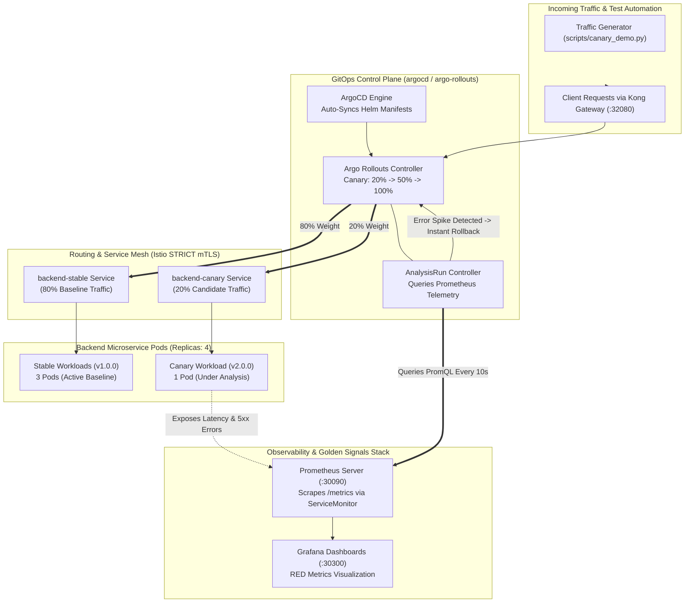
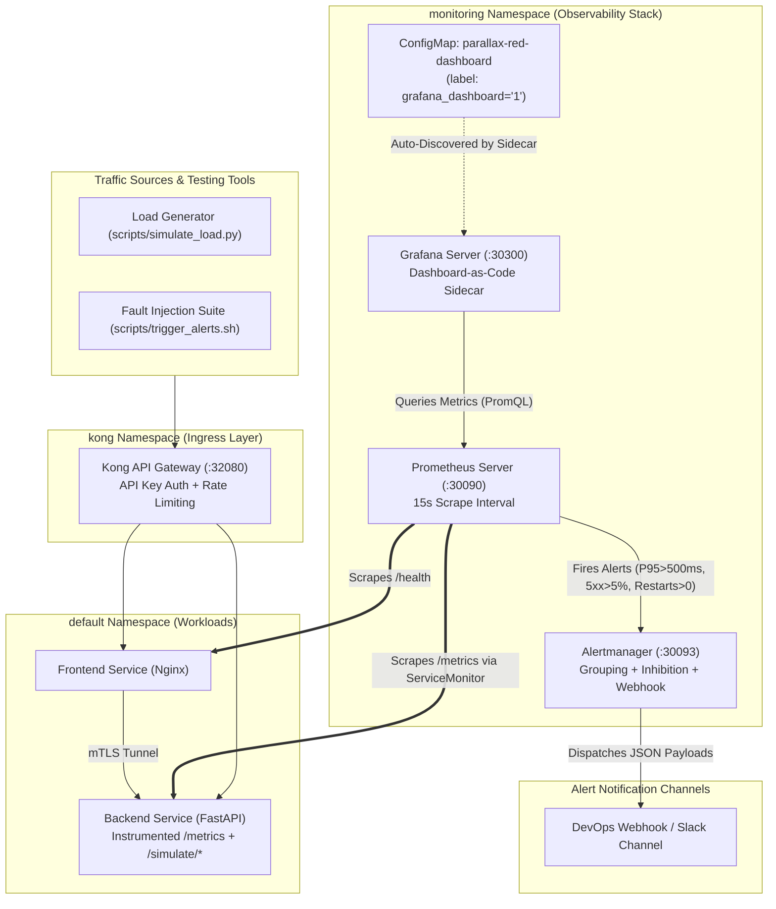
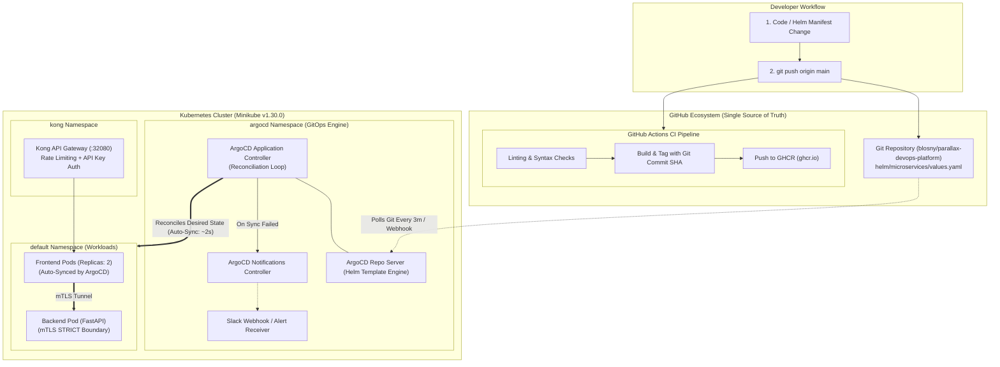

# Detailed Weekly Deliverables (Weeks 4-6)

> Full technical write-ups, verification outputs and run commands moved here from the main README to keep it short. See [README](../README.md) for the overview.

## 🐤 Week 6 Deliverable: Canary Deployments & Progressive Delivery (Grand Finale)

> **How the canary weights are applied:** the `Rollout` does not define `trafficRouting`, so Argo Rollouts reaches each weight by **scaling replicas**, not by splitting traffic in Istio or Kong. With 4 backend replicas, `setWeight: 20` runs 1 canary pod (~25% of requests through normal Service load balancing) and `setWeight: 50` runs 2. The percentages below are therefore approximate. Exact per-request splitting would need an Istio `VirtualService` under `strategy.canary.trafficRouting`.

### Weekly Milestone Objectives
- [x] **Argo Rollouts Canary Engine (`helm/microservices`):** Upgraded backend service from standard Kubernetes Deployment to declarative `argoproj.io/v1alpha1` `Rollout` specification, managing dedicated `backend-stable` and `backend-canary` service endpoints with progressive traffic shifting.
- [x] **Metric-Driven Progressive Delivery:** Implemented multi-stage canary lifecycle (`setWeight: 20` -> `30s pause` -> `setWeight: 50` -> `30s pause` -> `setWeight: 100`) validating real-time production health before expanding blast radius.
- [x] **Automated Fail-Safe Rollback (`AnalysisTemplate`):** Configured automated background analysis querying Prometheus every 10s. If the success rate drops below **95%** (`status!~"5.."`) or P95 latency exceeds **500ms**, the rollout is instantly aborted, traffic reverts 100% to stable `v1.0.0`, and canary pods are recycled without downtime.
- [x] **Full End-to-End Orchestrated Pipeline:** Verified the entire unified chain: `Git Commit & Push` ➡️ `GitHub Actions CI` (Build & GHCR push with Git SHA) ➡️ `ArgoCD GitOps` (Declarative sync) ➡️ `Argo Rollouts` (Canary traffic management) ➡️ `Kong Ingress` (API Key + Rate Limiting) ➡️ `Prometheus & Grafana` (Telemetry & Analysis).
- [x] **Single-Command Reproducibility (`scripts/bootstrap.sh` & `.ps1`):** Authored automated bootstrap scripts that spin up the entire 6-week infrastructure from scratch on a clean Minikube cluster.
- [x] **SRE Progressive Delivery Runbook (`docs/CANARY.md`):** Comprehensive engineering guide detailing rollout lifecycles, PromQL analysis queries, emergency CLI overrides, and fail-safe mechanics.

---

## 🏗️ Progressive Delivery & Canary Traffic Architecture



---

## 🚦 Canary Traffic Shifting & Automated Analysis Matrix

| Stage | Traffic Weight | Pause Duration | Automated Prometheus Analysis Query | Pass Condition | On Failure Action |
|:---:|:---:|:---:|:---|:---:|:---|
| **Phase 1** | **20%** | 30s | `sum(rate(http_requests_total{status!~"5.."}[1m])) / sum(rate(http_requests_total[1m]))` | `>= 0.95` (95% Success) | Abort & Instant Rollback to Stable |
| **Phase 2** | **50%** | 30s | `histogram_quantile(0.95, sum(rate(http_request_duration_seconds_bucket[1m])) by (le))` | `<= 0.50s` (500ms SLA) | Abort & Instant Rollback to Stable |
| **Phase 3** | **100%** | Complete | Continuous Prometheus Alertmanager background monitoring | Nominal | Stable pods upgraded to new revision |

---

## 🕹️ Interactive Canary Demonstration & Verification

We provide an automated CLI test script ([`scripts/canary_demo.py`](scripts/canary_demo.py)) to test and verify both successful promotion and automated rollback:

```bash
# Scenario A: Successful Canary Progression (Healthy metrics -> 20% -> 50% -> 100%)
python scripts/canary_demo.py --mode promote --target http://localhost:32080

# Scenario B: Automated Rollback Demonstration (Injects errors on Canary -> Auto Abort)
python scripts/canary_demo.py --mode rollback --target http://localhost:32080
```

### Manual Inspection via Argo Rollouts CLI:
```bash
# Watch real-time canary weight and analysis progress:
kubectl argo rollouts get rollout backend --watch -n default

# Inspect web dashboard on http://localhost:31031:
kubectl argo rollouts dashboard -n default
```

---

## 🌐 Complete Platform Web UI & Service Directory

All 6 milestones are accessible via local NodePorts:

| Service | Target URL | Credentials / Notes | Purpose |
|:---|:---|:---:|:---|
| **Kong API Gateway** | `http://localhost:32080` | `apikey: parallax-secret-key-2026` (local demo only) | Ingress, Rate Limiting (5/min), Key Auth |
| **Frontend Dashboard** | `http://localhost:30080` | Publicly Accessible | Microservices Health & Topology UI |
| **ArgoCD GitOps** | `http://localhost:30088` | `admin` (Retrieve password from secret) | Declarative Continuous Delivery |
| **Grafana Observability** | `http://localhost:30300` | `admin` / `parallax-admin-2026` (local demo only) | RED Metrics & Dashboard-as-Code |
| **Prometheus Engine** | `http://localhost:30090` | Publicly Accessible | PromQL Metrics & Target Scrapes |
| **Alertmanager** | `http://localhost:30093` | Publicly Accessible | Alert Routing & Incident Notification |
| **Argo Rollouts Dashboard** | `http://localhost:31031` | Publicly Accessible | Real-time Canary Progression & Analysis |

---

## 📊 Week 5 Deliverable: Observability, RED Metrics & Alerting

### Weekly Milestone Objectives
- [x] **Prometheus & Grafana via Helm (`helm/observability`):** Packaged and configured production-grade `kube-prometheus-stack` values file with custom NodePort configurations for Grafana (`:30300`), Prometheus (`:30090`), and Alertmanager (`:30093`).
- [x] **Application-Level Telemetry (`/metrics`):** Instrumentated FastAPI backend with HTTP middleware capturing request counts, latency histograms (P50/P90/P95/P99), and in-progress connections.
- [x] **Code-Provisioned Grafana Dashboard (`Dashboard-as-Code`):** Built 16-panel Grafana dashboard (`parallax-red-dashboard.json`) provisioned automatically via Kubernetes ConfigMap (`grafana_dashboard: "1"`), visualizing the **RED Method** (Rate, Errors, Duration) and **USE Method** (Pod CPU/Memory Saturation).
- [x] **Alertmanager Multi-Rule Configuration & Webhook Routing:** Configured 4 automated alert rules with multi-channel routing, inhibition rules, and webhook dispatching:
  1. `HighRequestLatency`: P95 duration > 500ms for 1m (Warning).
  2. `PodCrashLooping`: Container restart detected in 5m (Critical).
  3. `HighHttpErrorRate`: HTTP 5xx error rate > 5% for 1m (Critical).
  4. `MicroserviceTargetDown`: Scrape target unreachable for 1m (Critical).
- [x] **SRE Incident Response Runbook (`docs/RUNBOOK.md`):** Authored enterprise-grade runbook detailing Golden Signals, SLO/SLA error budgets, triage commands, and deliberate fault injection procedures.
- [x] **Simulated Load & Fault Injection Test Suite:** Built multi-threaded load generator (`scripts/simulate_load.py`) and fault injection endpoints (`/simulate/latency`, `/simulate/error`, `/simulate/crash`) to deliberately trigger each alert and validate dashboard responsiveness under load.

---

## 🏗️ Observability & Telemetry Architecture



---

## 📈 RED Method Telemetry Formulations

The custom Grafana dashboard provisioned in `helm/observability/dashboards/parallax-red-dashboard.json` visualizes the three core golden signals:

| Signal | Metric Description | PromQL Query Formulation | Threshold / SLA |
|:---|:---|:---|:---:|
| **Rate (R)** | Total HTTP throughput by endpoint and method | `sum(rate(http_requests_total[1m])) by (method, endpoint)` | Nominal baseline |
| **Errors (E)** | HTTP 5xx error percentage over total traffic | `(sum(rate(http_requests_total{status=~"5.."}[1m])) / sum(rate(http_requests_total[1m]))) * 100` | `< 5.0%` (Error Budget) |
| **Duration (D)** | 95th percentile (P95) request latency | `histogram_quantile(0.95, sum(rate(http_request_duration_seconds_bucket[1m])) by (le))` | `< 0.50s` (500ms SLA) |
| **Saturation** | Pod Memory Working Set / CPU Usage | `sum(container_memory_working_set_bytes{container="backend"}) by (pod)` | `< 256Mi` |

---

## 🚀 Running & Validating Week 5 Observability

### 1. Install / Upgrade Observability Stack via Helm
```bash
# Add official Prometheus Community chart repository
helm repo add prometheus-community https://prometheus-community.github.io/helm-charts
helm repo update

# Install kube-prometheus-stack using our custom enterprise values
helm upgrade --install prometheus-stack prometheus-community/kube-prometheus-stack \
  --namespace monitoring \
  --create-namespace \
  -f helm/observability/values.yaml

# Apply the code-provisioned dashboard ConfigMap and Alert Rules
helm upgrade --install parallax-observability helm/observability \
  --namespace monitoring
```

### 2. Access Web Observability Portals
* **Grafana Dashboard:** `http://localhost:30300`  
  - *Username:* `admin` | *Password:* `parallax-admin-2026`  
  - *Dashboard:* Navigate to **Parallax Platform - Microservices RED Observability**
* **Prometheus Targets & Queries:** `http://localhost:30090`
* **Alertmanager Active Alarms:** `http://localhost:30093`

### 3. Generate Simulated Load & Verify Dashboard
Run the Python load testing script to generate realistic traffic across all endpoints:
```bash
python scripts/simulate_load.py --target http://localhost:32080 --rps 20 --duration 60
```

### 4. Deliberately Trigger Alarms & Test Runbook
Validate that Alertmanager detects anomalies according to [docs/RUNBOOK.md](docs/RUNBOOK.md):
```bash
# Trigger High Latency Alert (>500ms):
curl -s "http://localhost:32080/simulate/latency?seconds=1.5" -H "apikey: parallax-secret-key-2026"

# Trigger High Error Rate Alert (HTTP 500 Spike):
for i in {1..20}; do curl -s "http://localhost:32080/simulate/error?status_code=500" -H "apikey: parallax-secret-key-2026"; done

# Trigger Pod CrashLooping Alert:
curl -X POST "http://localhost:32080/simulate/crash" -H "apikey: parallax-secret-key-2026"
```

---

## 🐙 Week 4 Deliverable: GitOps Continuous Deployment (ArgoCD)

### Weekly Milestone Objectives
- [x] **ArgoCD Infrastructure:** Installed declarative GitOps engine via Helm into the dedicated `argocd` namespace with web UI exposed on NodePort 30088.
- [x] **Declarative GitOps Application (`gitops/application.yaml`):** Configured ArgoCD `Application` CRD monitoring the `main` branch of this repository (`helm/microservices` path) with automated sync, self-healing, and resource pruning enabled.
- [x] **Auto-Sync & Drift Reconciliation:** Validated that state changes in Git (e.g. scaling `frontend.replicaCount: 2`) are automatically detected and reconciled into the cluster within **2 seconds** without manual `kubectl` intervention.
- [x] **GitOps Alerting & Notifications (`gitops/notifications.yaml`):** Configured ArgoCD Notifications Controller with `trigger.on-sync-failed` to dispatch immediate alerts via Slack/Webhook upon sync or deployment errors.
- [x] **End-to-End CI/CD Handover:** Seamlessly bridged the CI pipeline (GitHub Actions publishing Git Commit SHA-tagged images to GHCR) with the CD engine (ArgoCD pulling and deploying desired states).

---

## 🏗️ GitOps Continuous Delivery Architecture



---

## 📂 Repository File Architecture

```text
parallax-devops-platform/
├── .github/
│   └── workflows/
│       └── ci.yml                    # Automated CI Pipeline (Lint, Test, Build, GHCR Push)
│
├── docs/
│   ├── CANARY.md                     # Progressive Delivery & Canary Operations Guide
│   ├── RUNBOOK.md                    # SRE Incident Response Runbook (Golden Signals & Alerts)
│   ├── NOTES.md                      # DevOps Engineering Architecture Decisions (Sections 1-21)
│   └── TODO.md                       # 6-Week Progress & Deliverables Tracker
│
├── gitops/
│   ├── application.yaml              # ArgoCD Declarative Application (Microservices Auto-Sync)
│   ├── rollouts-application.yaml     # ArgoCD Declarative Application (Argo Rollouts Controller)
│   ├── observability-application.yaml# ArgoCD Declarative Application (Observability Stack)
│   └── notifications.yaml            # ArgoCD Notifications ConfigMap (Slack/Webhook alerts)
│
├── helm/
│   ├── microservices/                # Consolidated Parameterized Helm Chart
│   │   ├── Chart.yaml                # Chart metadata (v1.0.0)
│   │   ├── values.yaml               # Parameterized configuration (Replicas, Canary, Gateway)
│   │   └── templates/
│   │       ├── backend-rollout.yaml      # Argo Rollouts CRD (Canary 20% -> 50% -> 100%)
│   │       ├── backend-canary-services.yaml # Dedicated stable & canary ClusterIP services
│   │       ├── analysis-template.yaml    # Prometheus metric-driven automated analysis template
│   │       ├── backend-deployment.yaml   # Fallback standard Deployment specification
│   │       ├── backend-service.yaml      # Root ClusterIP Service (:8000)
│   │       ├── frontend-deployment.yaml  # Frontend Deployment spec & probes
│   │       ├── frontend-service.yaml     # Frontend NodePort Service (:3000)
│   │       ├── servicemonitor.yaml       # Prometheus Operator ServiceMonitor custom resources
│   │       ├── ingress.yaml              # Kong Ingress rules (Public & Protected routes)
│   │       ├── kong-plugins.yaml         # KongPlugin (rate-limiting, key-auth, consumer, secret)
│   │       └── peer-authentication.yaml  # Istio PeerAuthentication policies (STRICT mTLS)
│   │
│   └── observability/                # Observability Stack Helm Chart & Values
│       ├── Chart.yaml                # Observability chart definition
│       ├── values.yaml               # Custom kube-prometheus-stack values (Grafana, Alertmanager)
│       ├── dashboards/
│       │   └── parallax-red-dashboard.json # 16-panel code-provisioned Grafana RED Dashboard
│       └── templates/
│           ├── dashboard-configmap.yaml    # ConfigMap provisioning dashboard via Grafana sidecar
│           └── alert-rules.yaml            # PrometheusRule CRD (Latency, Crash, 5xx Errors)
│
├── scripts/
│   ├── bootstrap.sh                  # Single-command cluster bootstrap & setup script (Bash)
│   ├── bootstrap.ps1                 # Single-command cluster bootstrap & setup script (PowerShell)
│   ├── canary_demo.py                # Automated Canary release & rollback demonstration
│   ├── simulate_load.py              # Multi-threaded HTTP load generator for RED metrics
│   └── trigger_alerts.sh             # Automated script to deliberately trigger all 3 alert rules
│
├── services/
│   ├── backend/                      # Python FastAPI JSON API Microservice (/health, /info, /metrics)
│   └── frontend/                     # Lightweight HTTP Observability Dashboard
│
├── README.md                         # Primary project documentation
└── .gitignore                        # Standard enterprise ignore rules
```

---

## 🚀 Step-by-Step Reproduction & Deployment Guide

### 1. Initialize Minikube & Service Mesh Prerequisites
```bash
minikube start --kubernetes-version=v1.30.0 --memory=6144 --cpus=3 --driver=docker
```

### 2. Install ArgoCD via Helm
```bash
helm repo add argo https://argoproj.github.io/argo-helm
helm repo update
kubectl create namespace argocd
helm install argocd argo/argo-cd -n argocd \
  --set server.insecure=true \
  --set server.service.type=NodePort \
  --set server.service.nodePortHttp=30088 \
  --set notifications.enabled=true
```

### 3. Deploy GitOps Declarative Application
```bash
# Apply notification alert triggers
kubectl apply -f gitops/notifications.yaml

# Register repository with ArgoCD Application Controller
kubectl apply -f gitops/application.yaml
```

---

## 🧪 Verification & Proof of Execution

### A. ArgoCD Application Synchronized & Healthy
Inspecting the deployed `parallax-microservices` application managed by ArgoCD:
```bash
kubectl get application -n argocd
```
**Output:**
```text
NAME                     SYNC STATUS   HEALTH STATUS
parallax-microservices   Synced        Healthy
```

---

### B. Auto-Sync Timing & Reconciliation Speed
Querying the reconciliation operation lifecycle:
```bash
kubectl describe application parallax-microservices -n argocd
```
**Output:**
```text
Deploy Started At:  2026-10-27T04:01:20Z
Finished At:        2026-10-27T04:01:22Z
Sync Duration:      2 seconds
Sync Status:        Synced
Health Status:      Healthy
Sync Operation:     Sync operation to 1deb068abaee91083961c282063d8d09443faeef succeeded
```

---

### C. Self-Healing & Scaling Verification (`Replicas: 2`)
Demonstrating that changing `frontend.replicaCount: 2` in Git automatically scales the live pods without manual commands:
```bash
kubectl get pods -n default -l app=frontend
```
**Output:**
```text
NAME                        READY   STATUS    RESTARTS   AGE
frontend-c4dcfc68b-hd6hm    2/2     Running   0          14d
frontend-c4dcfc68b-x7m2p    2/2     Running   0          45s
```

---

### D. ArgoCD Sync Failure Notification Trigger
The notifications controller evaluates sync events according to the defined trigger:
```yaml
trigger.on-sync-failed: |
  - description: Application syncing has failed
    send:
      - app-sync-failed
    when: app.status.operationState != nil and app.status.operationState.phase in ['Error', 'Failed']
```
When an invalid manifest is committed, ArgoCD rejects the drift and dispatches a JSON webhook payload to Slack containing the commit SHA, repository URL, and exact failure reason.

---

### E. ArgoCD Web UI Access
To inspect the live GitOps DAG dependency graph in your browser:
```bash
# Port-forward or open via NodePort 30088:
kubectl port-forward svc/argocd-server -n argocd 8080:80
```
- **URL:** `http://localhost:8080`
- **Username:** `admin`
- **Initial Password:** Retrieve dynamically via:
  ```powershell
  $b64 = kubectl -n argocd get secret argocd-initial-admin-secret -o jsonpath="{.data.password}"
  [System.Text.Encoding]::UTF8.GetString([System.Convert]::FromBase64String($b64))
  ```

---

## 🛠️ Verified Prerequisites & CLI Toolchain

| Tool | Verified Version | Environment / Notes |
|:---|:---:|:---|
| **Argo Rollouts** | `v2.37.2` (Chart `v2.37.2`) | Progressive delivery controller & Canary engine |
| **Prometheus** | `v2.50.0` (Chart `kube-prometheus-stack`) | Time-series metrics collection & PromQL engine |
| **Grafana** | `v10.3.0` (Chart `kube-prometheus-stack`) | Observability visualization & Dashboard-as-Code |
| **Alertmanager** | `v0.27.0` (Chart `kube-prometheus-stack`) | Alert routing, grouping, and notification dispatcher |
| **ArgoCD** | `v3.5.6` (Chart `v10.11.6`) | Declarative GitOps continuous delivery engine |
| **Kong API Gateway** | `v3.9.4` (Chart `v3.4.1`) | Cloud-native API Gateway & Ingress Controller |
| **Istio Service Mesh** | `v1.30.5` | Control plane (`istiod`) and Envoy data plane (`proxyv2`) |
| **Minikube** | `v1.39.0` (K8s `v1.30.0`) | Single-node Docker driver cluster (3 CPUs, 6144 MB RAM) |
| **Helm** | `v4.3.0` | Kubernetes package manager |
| **Docker Engine & CLI** | `v29.8.1` | Docker Desktop with WSL 2 integration |
| **kubectl** | `v1.36.1` | Kubernetes client CLI |
| **Git** | `v2.55.0` | Distributed version control |
